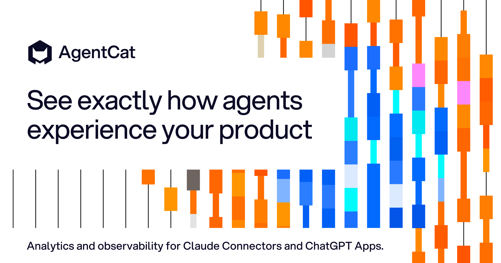
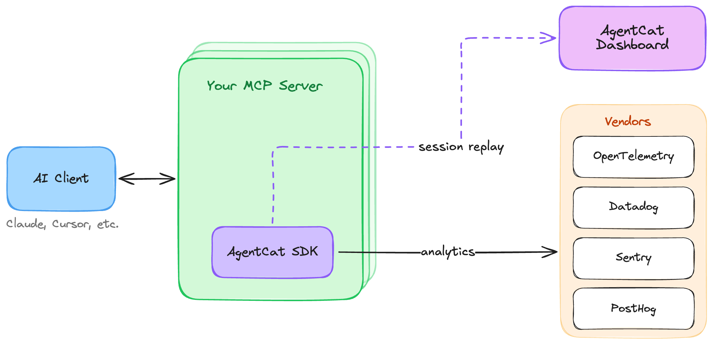
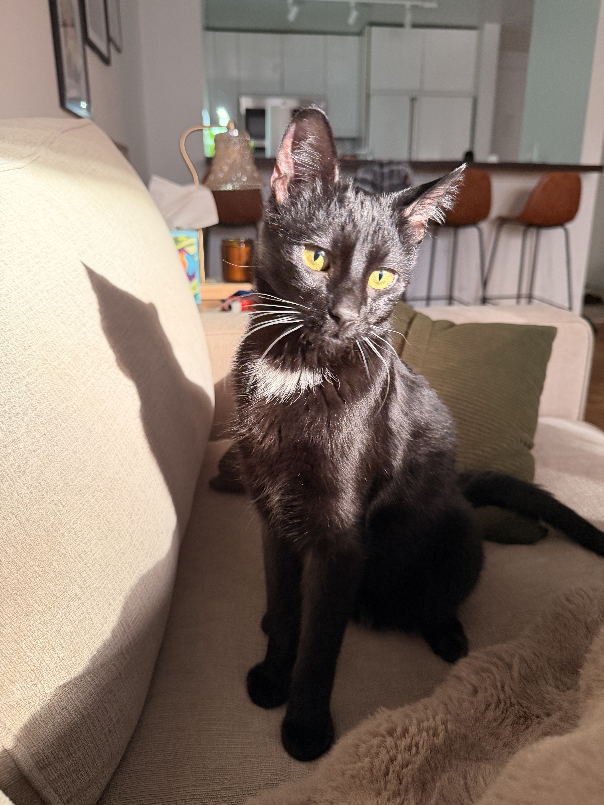

<div align="center">
  
</div>
<h3 align="center">
    <a href="#getting-started">Getting Started</a>
    <span> · </span>
    <a href="#why-use-agentcat-">Features</a>
    <span> · </span>
    <a href="https://docs.agentcat.com">Docs</a>
    <span> · </span>
    <a href="https://agentcat.com">Website</a>
    <span> · </span>
    <a href="#free-for-open-source">Open Source</a>
    <span> · </span>
    <a href="https://book.agentcat.com/meet">Schedule a Demo</a>
</h3>
<p align="center">
  <a href="https://rubygems.org/gems/agentcat"></a>
  <a href="https://rubygems.org/gems/agentcat"></a>
  <a href="https://opensource.org/licenses/MIT"></a>
  <a href="https://www.ruby-lang.org/"></a>
  <a href="https://github.com/agentcathq/agentcat-ruby-sdk/issues"></a>
  <a href="https://github.com/agentcathq/agentcat-ruby-sdk/actions"></a>
</p>

> [!NOTE]
> AgentCat v2 introduces compatibility with the [MCP Protocol "Stateless" 2026-07-28 Update](https://blog.modelcontextprotocol.io/posts/2026-07-28/) and the coinciding [MCP Ruby SDK](https://github.com/modelcontextprotocol/ruby-sdk) (`mcp` gem) releases that put it into effect. The stateless transition has a massive impact on analytics, as sessions were a built-in concept tying related tool calls together. AgentCat has now migrated its session tracking under guidance of the MCP core team's recommendations of using [explicit handles (SEP-2567)](https://github.com/modelcontextprotocol/modelcontextprotocol/pull/2567).
>
> As a result AgentCat now injects a `session_id` on every MCP tool call to associate them under the same task umbrella. Our evals show much higher tool correlation accuracy at the cost of < 1% additional context pollution.

> [!IMPORTANT]
> **MCPcat is now AgentCat** 🐱 — same team, same product, new name. The Ruby SDK was never published under the old `mcpcat` name, so there is nothing to migrate.

AgentCat is an analytics platform for MCP server owners 🐱. It captures user intentions and behavior patterns to help you understand what AI users actually need from your tools — eliminating guesswork and accelerating product development all with one-line of code.

This SDK also provides a free and simple way to forward telemetry like logs, traces, and errors to any Open Telemetry collector or popular tools like Datadog, Sentry, and PostHog.

```bash
bundle add agentcat
```

To learn more about us, check us out [here](https://agentcat.com). For detailed guides visit our [documentation](https://docs.agentcat.com).

## Why use AgentCat? 🤔

AgentCat helps builders of MCP servers, Claude Connectors, and ChatGPT Plugins learn how to improve them by capturing any agents goals and detecting when they get stuck.

Use AgentCat for:

- **Agent session replay** 🎬. Follow alongside your users and their agents to understand why they're using your MCP servers, what functionality you're missing, and what clients they're coming from.
- **Trace debugging** 🔍. See where your users are getting stuck, track and find when LLMs get confused by your API, and debug sessions across all deployments of your MCP server.
- **Existing platform support** 📊. Get logging and tracing out of the box for your existing observability platforms (OpenTelemetry, Datadog, Sentry, PostHog) — eliminating the tedious work of implementing telemetry yourself.



## How it works

AgentCat works as a lightweight middleware inside your MCP server. When you call `AgentCat.track`, it seamlessly modifies your registered tool schemas in place, following the MCP core team's [explicit handles (SEP-2567)](https://github.com/modelcontextprotocol/modelcontextprotocol/pull/2567) guidelines. Concretely, AgentCat adds the following to your server:

- **`session_id`** — a parameter injected into each tool's input schema. Agents echo it back on every call, letting AgentCat group related tool calls into one task even over stateless transports. Values are validated: anything AgentCat did not issue is rejected rather than adopted, and the agent is told to re-send the ID it was given.
- **`agent_id`** _(off by default)_ — enabled with `enable_agent_tracking: true`. Each agent self-generates its own ID, keeping parallel agents working the same task individually attributable.
- **`context`** — a parameter asking the agent to explain, in one sentence, why it is making this call. This is where intent data comes from.
- **`get_more_tools`** — an additional tool, prompt-engineered so that agents readily report the features and tools they looked for but couldn't find — surfacing your missing functionality directly from real usage.

Injected parameters are stripped from arguments before your tool handler runs, so your code never sees them. For tools that declare an output schema, issued IDs are also mirrored into `structuredContent` (as `mcp_session`), so clients that only read structured results still receive them.

## Getting Started

To get started with AgentCat, first create an account and obtain your project ID by signing up at [agentcat.com](https://agentcat.com). For detailed setup instructions visit our [documentation](https://docs.agentcat.com).

Stateless servers built on [MCP 2026-07-28](https://blog.modelcontextprotocol.io/posts/2026-07-28/) create a fresh server instance per request. Call `AgentCat.track` inside the factory so every instance is tracked:

```ruby
# config.ru
require "mcp"
require "mcp/server/transports/streamable_http_transport"
require "agentcat"

def build_server
  echo = MCP::Tool.define(
    name: "echo",
    description: "Echo a message",
    input_schema: {type: "object", properties: {msg: {type: "string"}}, required: ["msg"]}
  ) do |msg:, **|
    MCP::Tool::Response.new([{type: "text", text: msg}])
  end

  server = MCP::Server.new(name: "echo-mcp", version: "0.1.0", tools: [echo])

  # Track the server with AgentCat
  AgentCat.track(server, "proj_0000000")
end

run ->(env) { MCP::Server::Transports::StreamableHTTPTransport.new(build_server, stateless: true).call(env) }
```

Calling `AgentCat.track` per instance is cheap — the event queue, telemetry exporters, and diagnostics are initialized once and shared across instances.

For a long-lived server, such as one over stdio, track it once:

```ruby
require "mcp"
require "mcp/server/transports/stdio_transport"
require "agentcat"

server = MCP::Server.new(name: "echo-mcp", version: "0.1.0", tools: [echo]) # your tools

# Track the server with AgentCat
AgentCat.track(server, "proj_0000000")

MCP::Server::Transports::StdioTransport.new(server).open
```

`AgentCat.track` never raises into your setup code: if setup fails, it logs an error and returns your server untracked. Call `AgentCat.flush(timeout: 5)` before your process exits to send queued events.

### Identifying users

We strongly encourage identifying every actor. If you can't resolve a real user, return a stable anonymized ID instead — for example, a hash of the auth token or API key — so that all events from the same end user still roll up to one actor in your dashboard rather than scattering into anonymous one-off sessions.

A slow lookup — or a hook that fails outright — costs analytics data for that event, never your tool's response. Every hook runs under a timeout (1 second by default), so add your own caching if it does a database or API lookup.

The callback receives an `AgentCat::ToolCall`: the tool name, the arguments and `_meta` of the call, the HTTP headers (lower-case names, empty on stdio), the client's name and version, and the `mcp` gem's server context. Most identity signals live in its `headers`:

```ruby
AgentCat.track(server, "proj_0000000", AgentCat::Options.new(
  identify: lambda do |tool_call|
    token = tool_call.headers["authorization"]&.delete_prefix("Bearer ")
    user = MyApi.get_user(token)
    next nil unless user

    AgentCat::UserIdentity.new(
      user_id: user.id,
      user_name: user.name,
      user_data: {org_id: user.org_id}
    )
  end
))
```

The `mcp` gem has no auth of its own. If your app authenticates the request, put what it knows in the server's `server_context` as `auth_info:` (a Hash such as `{"clientId" => ..., "scopes" => [...]}`), and AgentCat sends it with the event. Do not put raw tokens there.

### Tags and properties

The `event_tags` and `event_properties` hooks get the same `AgentCat::ToolCall`, and add your own data to each event:

```ruby
AgentCat.track(server, "proj_0000000", AgentCat::Options.new(
  # Tags: String keys and values, for filtering in the dashboard.
  event_tags: ->(tool_call) { {"tenant" => tool_call.headers["x-tenant-id"].to_s} },
  # Properties: any JSON-friendly Hash, merged into the event.
  event_properties: ->(tool_call) { {"argument_count" => tool_call.arguments.size} }
))
```

### Redacting sensitive data

AgentCat redacts all data sent to its servers and encrypts at rest, but for additional security, it offers a hook to do your own redaction on all text data returned back to our servers.

```ruby
AgentCat.track(server, "proj_0000000", AgentCat::Options.new(
  redact_sensitive_information: ->(text) { MyRedactor.call(text) }
))
```

For redaction decisions that need more context than a single string — such as which tool was called or what type of event is being published — use the event-level `redact_event` hook. It receives the full event and returns a modified event, or `nil` to drop the event entirely. It can be combined with `redact_sensitive_information`. If a redaction hook fails, AgentCat drops the event rather than send it unredacted.

```ruby
AgentCat.track(server, "proj_0000000", AgentCat::Options.new(
  redact_event: lambda do |event|
    # Drop events from tools that handle secrets entirely
    next nil if event.resource_name == "get_credentials"
    # Strip response payloads from a specific tool
    event.response = nil if event.resource_name == "export_report"
    event
  end
))
```

### Vendor Support

AgentCat seamlessly integrates with your existing observability stack, providing automatic logging and tracing without the tedious setup typically required. Export telemetry data to multiple platforms simultaneously:

```ruby
AgentCat.track(server, "proj_0000000", AgentCat::Options.new(
  # Project ID can optionally be nil if you just want to forward telemetry
  exporters: [
    AgentCat::Exporters::Otlp.new(
      endpoint: "http://localhost:4318"
    ),
    AgentCat::Exporters::Datadog.new(
      api_key: ENV["DD_API_KEY"],
      site: "datadoghq.com",
      service: "my-mcp-server"
    ),
    AgentCat::Exporters::Sentry.new(
      dsn: ENV["SENTRY_DSN"],
      environment: "production"
    ),
    AgentCat::Exporters::PostHog.new(
      api_key: ENV["POSTHOG_API_KEY"],
      host: "https://us.i.posthog.com" # Optional: defaults to US region
    )
  ]
))
```

Learn more about our free and open source [telemetry integrations](https://docs.agentcat.com/telemetry/integrations).

### Testing your server

In a test environment, AgentCat does nothing: `AgentCat.track` returns your server untouched, and no events are sent. A test environment is a process where Minitest or RSpec is loaded, or where `RAILS_ENV`, `RACK_ENV` or `APP_ENV` is `test`.

To check what your server tracks, call `AgentCat.fake` before `AgentCat.track`. The fake records every event in memory and sends nothing:

```ruby
class EchoServerTest < Minitest::Test
  def setup
    @agentcat = AgentCat.fake
    @server = build_server
  end

  def teardown
    AgentCat.reset!
  end

  def test_echo_is_tracked
    @server.handle({jsonrpc: "2.0", id: 1, method: "tools/call", params: {name: "echo", arguments: {msg: "hi"}}})

    @agentcat.assert_tracked("echo", count: 1)
  end
end
```

Set `AGENTCAT_ENABLED=false` to turn AgentCat off everywhere, or `AGENTCAT_ENABLED=true` to turn it on in tests as well.

### Logging

AgentCat writes WARN and ERROR lines to `$stderr` through `AgentCat.logger`. Set your own logger with `AgentCat.logger = Rails.logger`. The lines never contain your payload values. Set `AgentCat.debug = true` to also write setup and delivery lines to `~/agentcat.log`.

### Internal diagnostics

To help us catch and fix broken installs, the SDK sends AgentCat a small, anonymized
signal when setup or runtime errors occur — never your tool calls, your responses,
or anything about your users. Records carry only operational metadata, such as your
project ID (or an anonymous install ID when none is set).

Diagnostics are on by default and can be turned off completely with either:

- `AgentCat.track(server, project_id, AgentCat::Options.new(disable_diagnostics: true))`, or
- the `AGENTCAT_DISABLE_DIAGNOSTICS` environment variable.

### Compatibility

AgentCat supports Ruby 3.3 and newer, and the `mcp` gem from 0.23.0. CI tests every minor release of the `mcp` gem from 0.23.0 on, every night, so a new release is tested the day it comes out.

## Free for open source

AgentCat is free for qualified open source projects. We believe in supporting the ecosystem that makes MCP possible. If you maintain an open source MCP server, you can access our full analytics platform at no cost.

**How to apply**: Email [hi@agentcat.com](mailto:hi@agentcat.com) with your repository link

_Already using AgentCat? We'll upgrade your account immediately._

## Community Cats 🐱

Meet the cats behind AgentCat! Add your cat to our community by submitting a PR with your cat's photo in the `docs/cats/` directory.

<div align="left">
  
  
  
</div>

_Want to add your cat? Create a PR adding your cat's photo to_ `docs/cats/` _and update this section!_
